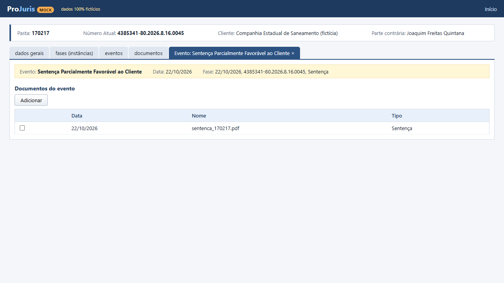
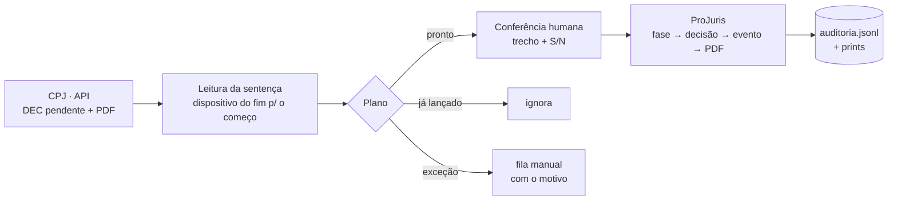
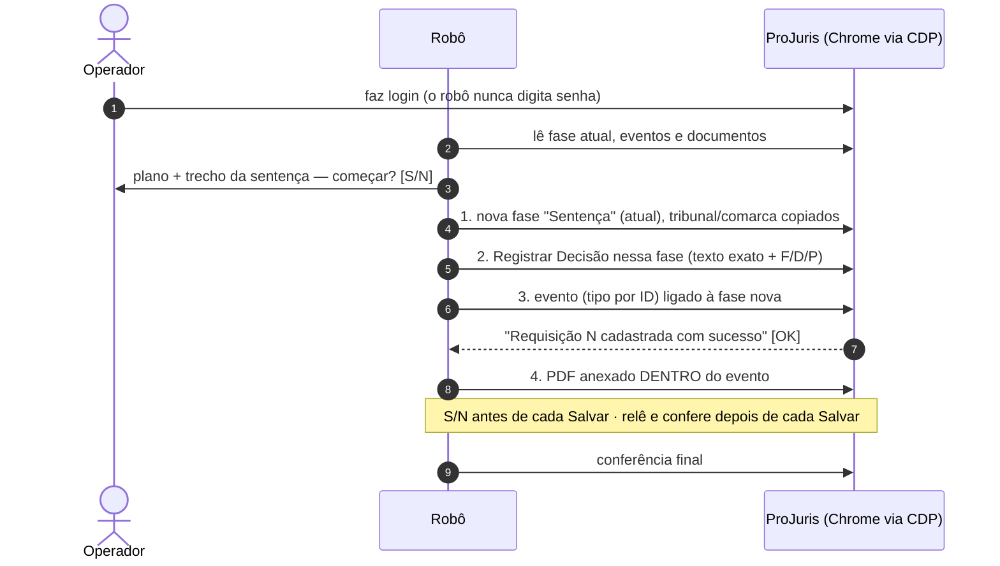
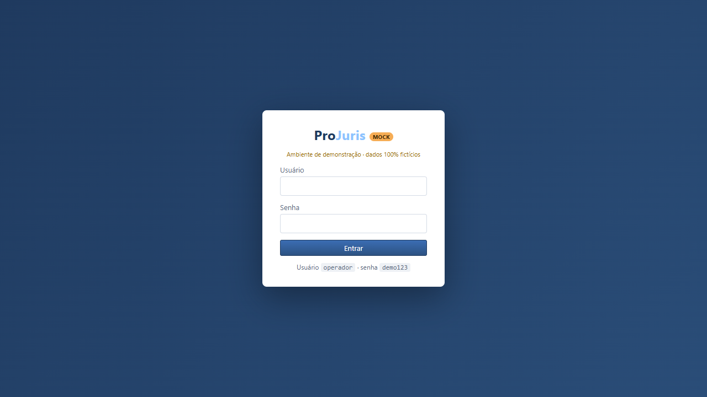
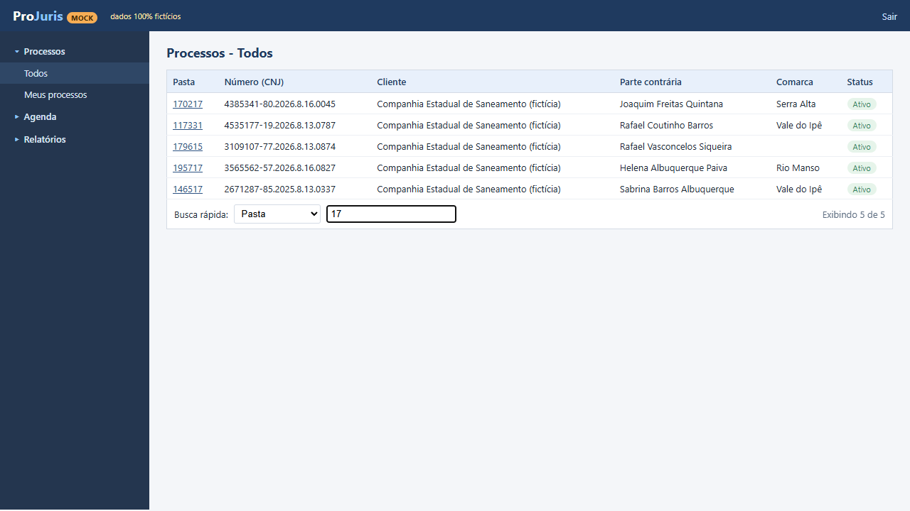
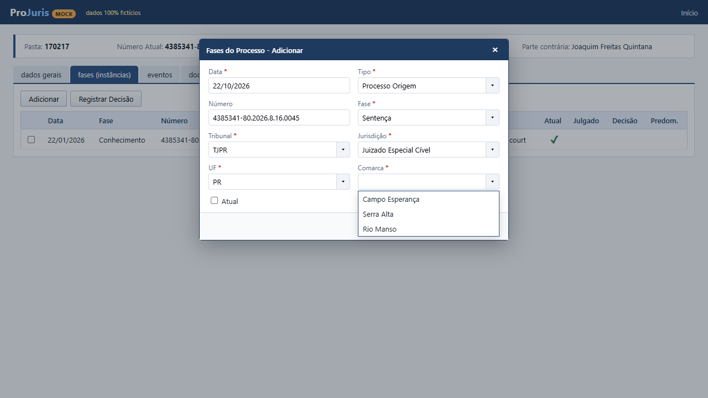
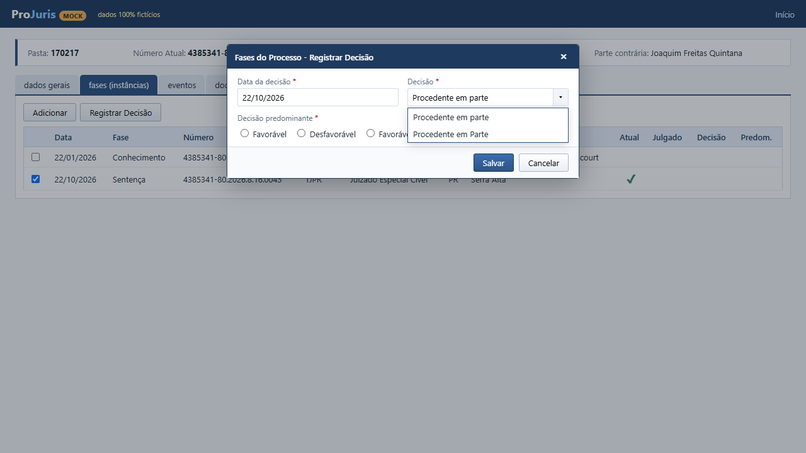
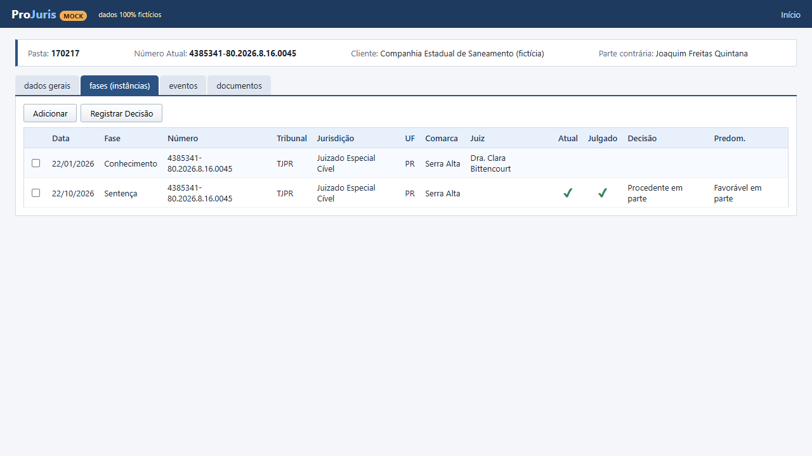
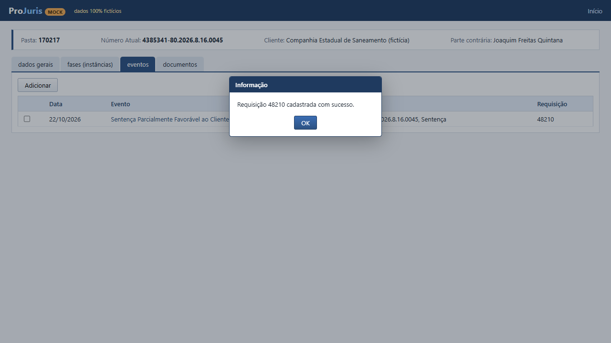

<div align="center">

# ⚖️ rpa-sentencas-projuris

**Robô que lê a sentença, sugere o resultado, pede conferência humana e lança tudo no sistema jurídico — sem chutar nunca.**


</div>

> [!NOTE]
> **Versão de portfólio, sanitizada.** Este repositório é uma reimplementação limpa de uma automação
> que construí para um escritório de advocacia. **Nenhum dado real** está aqui: clientes, processos,
> números de CNJ, IDs, nomes e textos de sentença são **fictícios**, gerados por `mock/seed.py`.
> Os dois sistemas usados pelo robô (CPJ e ProJuris) são **mocks locais executáveis**, então o
> projeto roda de ponta a ponta em qualquer máquina com um comando.

---

## Sumário

- [O problema](#-o-problema)
- [A solução](#-a-solução)
- [Funcionalidades](#-funcionalidades)
- [Como funciona](#-como-funciona)
- [Regras DEC → ProJuris](#-regras-dec--projuris)
- [O classificador do dispositivo](#-o-classificador-do-dispositivo)
- [Decisões de engenharia e lições aprendidas](#-decisões-de-engenharia-e-lições-aprendidas)
- [Quickstart](#-quickstart)
- [Referência do CLI](#-referência-do-cli)
- [Estrutura do projeto](#-estrutura-do-projeto)
- [Testes](#-testes)
- [Roadmap](#-roadmap)
- [Licença e autor](#-licença)

---

## 🧩 O problema

No contencioso de massa de um cliente do setor de saneamento, cada sentença publicada precisa ser
registrada **duas vezes**:

1. no **CPJ** (sistema interno do escritório), onde a equipe jurídica já classifica a decisão com um
   evento `DECx` — *favorável*, *desfavorável*, *parcialmente favorável* ou *sem mérito* para o cliente
   — e anexa o PDF da sentença;
2. no **ProJuris Enterprise** (sistema do cliente), onde a mesma sentença vira **quatro cadastros**:
   uma fase nova "Sentença", o registro da decisão nessa fase, um evento ligado a ela e o PDF anexado
   dentro do evento.

O segundo passo é manual, repetitivo e cheio de armadilhas: o resultado *Procedente/Improcedente*
**não** decorre do DEC, as listas têm opções duplicadas, combos dependentes não carregam se você
"pular" a interação, e lançar duas vezes gera retrabalho no cliente.

## 💡 A solução

Um robô em Python que:

- **lê o CPJ pela API** (só leitura) e encontra os DECs pendentes com PDF;
- **lê o dispositivo da sentença** e **sugere** Procedente / Improcedente / Procedente em parte,
  mostrando o trecho para uma pessoa conferir — e manda para **exceção** tudo que for ambíguo;
- **cruza com o ProJuris** (pasta → processo, CNJ, já lançado?, fase atual) usando a sessão que o
  operador abriu no Chrome — **o robô nunca faz login**;
- gera um **plano em planilha** (`pronto` / `já lançado` / `exceção`), **ensaia** os formulários sem
  salvar e, só para processos liberados, **grava** perguntando S/N antes de cada Salvar e
  **conferindo** cada passo.

<div align="center">

<br><sub>Resultado de uma gravação no mock: evento ligado à fase "Sentença" com o PDF dentro dele.</sub>
</div>

## ✨ Funcionalidades

- 🔎 **Varredura paralela do CPJ** com `ThreadPoolExecutor`, paginação e retry em 401/429/5xx.
- 🛡️ **Erro nunca vira "não encontrado"**: falha da API interrompe com código 3, em vez de pular processo.
- 👥 **Filtro de grupo de trabalho em cada registro**, não só na consulta.
- 📄 **Leitura do dispositivo de trás para frente**, tolerante a termos colados pelo pypdf.
- 🙅 **Nunca chuta**: conflito, PDF escaneado ou resultado que não combina com o DEC → exceção.
- 📊 **Plano em `.xlsx`** com linhas coloridas por situação e aba de resumo.
- 🧪 **Modo ENSAIO**: preenche as 4 telas, tira print e fecha pelo X — nada é salvo.
- ✍️ **Modo GRAVAÇÃO** com lista de liberados, S/N antes de **cada** Salvar, conferência depois de
  cada Salvar e `auditoria.jsonl` + prints.
- 🔁 **Retomada** (`anexar`) quando a gravação parou depois do evento.
- 🔐 **O robô nunca digita senha**: sessão caiu → para com código 2.
- 🧰 **Mock completo** (FastAPI): API do CPJ + interface "tipo ProJuris" com combos dependentes,
  opções duplicadas, campos obrigatórios e avisos.
- ▶️ **Demo de um comando** (`python demo.py`) que sobe tudo, abre um Chrome isolado e roda o fluxo.

## 🔄 Como funciona



O lançamento no ProJuris segue a mesma ordem que a equipe faz à mão:



Mais detalhes (módulos, estados do planejador, mock vs. real) em [`docs/arquitetura.md`](docs/arquitetura.md).

## 📋 Regras DEC → ProJuris

O DEC diz se a decisão foi boa ou ruim **para o cliente** — isso define o **evento** e a
**decisão predominante**. O resultado jurídico (Procedente/Improcedente) vem da **leitura da sentença**.

| DEC (CPJ) | Evento no ProJuris (ID fictício) | Predominante | Decisão aceita |
|---|---|:---:|---|
| `DEC1` Sentença Cível Favorável | Sentença Favorável ao Cliente (4101) | **F** | Improcedente *ou* Procedente (lida na sentença) |
| `DEC2` Sentença Cível Desfavorável | Sentença Desfavorável ao Cliente (4102) | **D** | Procedente *ou* Improcedente (lida na sentença) |
| `DEC3` Sentença Cível Parcialmente Favorável | Sentença Parcialmente Favorável ao Cliente (4103) | **P** | só "Procedente em parte" |
| `DEC13` Sentença Sem Resolução do Mérito | Sentença Sem Resolução de Mérito (4113) | **F** | fixa: "Decisão Sem julgamento de Mérito" |

A nova fase é sempre "Sentença", tipo "Processo Origem", marcada como **atual**, com
tribunal/jurisdição/UF/comarca copiados da fase atual. Todas as datas = data da publicação (SNE).

## 🧠 O classificador do dispositivo

`robo/sentencas/decisao.py` é o coração do robô:

1. **Extrai o texto** do PDF com pypdf e normaliza (minúsculas, sem acento) **mantendo o tamanho**,
   para recortar o trecho no texto original depois.
2. **Procura os marcadores do dispositivo do FIM para o começo** — `DISPOSITIVO`, `Ante o exposto`,
   `Diante do exposto`, `Isso posto`, `Posto isso`, `Pelo exposto`, `Ex positis`... — e usa o último
   cuja janela (1.500 caracteres) contenha um resultado.
3. **Mascara pedido contraposto e reconvenção** (troca por espaços), porque não definem o resultado da ação.
4. **Classifica** com prioridade: `parcial` › `procedente × improcedente` (os dois sem "parcial" =
   **conflito**) › `sem resolução do mérito`.
5. Devolve a **sugestão + o trecho** para a pessoa conferir. `avaliar(regra, sugestao)` cruza com o DEC.

| Trecho (fictício) | Sugestão |
|---|---|
| `Ante o exposto, JULGO IMPROCEDENTES os pedidos.` | Improcedente |
| `JULGO PARCIALMENTEPROCEDENTES os pedidos` *(colado pelo pypdf)* | Procedente em parte |
| `opino pela IMPROCEDÊNCIA dospedidos` | Improcedente |
| `Rejeito a preliminar...` (fundamentação) + `DISPOSITIVO ... julgo PROCEDENTE` | Procedente |
| `JULGO IMPROCEDENTES os pedidos da ação e PARCIALMENTE PROCEDENTE a reconvenção` | Improcedente |
| `JULGO EXTINTO o processo, sem resolução do mérito` | Decisão Sem julgamento de Mérito |
| `JULGO PROCEDENTE o pedido A e IMPROCEDENTE o pedido B` | ⚠️ exceção (conflito) |
| PDF escaneado (sem texto) | ⚠️ exceção |
| DEC3 + texto "improcedente" | ⚠️ exceção (não combina com o DEC) |

## 🛠️ Decisões de engenharia e lições aprendidas

> As partes mais valiosas do projeto não são as linhas que preenchem formulário, e sim as travas.

1. **Nunca chutar; humano no circuito.** O robô *sugere* e mostra o trecho do dispositivo; ambíguo,
   conflitante ou ilegível vai para exceção com o motivo escrito. Um lançamento errado num sistema do
   cliente custa muito mais caro que um item na fila manual.
2. **Favorável ≠ improcedente.** A intuição "favorável ao cliente = improcedente" falha quando o
   cliente é autor. Por isso o DEC define só o evento e a predominante; o resultado jurídico vem do texto.
3. **Ler só o dispositivo, de trás para frente.** O relatório cita decisões de outros processos e a
   fundamentação "rejeita preliminares". Ler a partir do último marcador evita esses falsos positivos.
4. **pypdf junta termos.** `parcialmenteprocedentes`, `dospedidos`, `Anteo exposto`: todos os padrões
   usam `\s*` entre os termos. E os testes cobrem isso explicitamente.
5. **Casamento mais à esquerda engana.** A máscara de reconvenção, com um intervalo "preguiçoso",
   engolia também o `PROCEDENTE` da ação em *"procedente a ação e improcedente a reconvenção"*. Um teste
   novo pegou; a correção foi proibir outro `proceden...` dentro do intervalo (lookahead negativo).
6. **Combos dependentes só disparam com interação humana.** Escolher a UF por código não carrega as
   comarcas (o filtro escuta o *select* do item). O robô digita e **clica no item da lista**, e confere
   o valor que ficou. O mock reproduz isso de propósito.
7. **Seleção por texto exato (ou ID).** O cadastro tem "Procedente em parte" **e** "Procedente em Parte".
   O robô tenta o texto exato; se só bater normalizando e houver mais de um, é erro. Tipos de evento são
   escolhidos pelo **ID**, porque há nomes parecidos (ex.: "(inativo)").
8. **Conferir depois de cada Salvar.** Clique perdido, validação silenciosa ou lentidão acontecem.
   Depois de cada Salvar o robô relê os dados e só segue se o registro estiver lá.
9. **Não responder avisos inesperados.** Se aparecer uma pergunta depois do Salvar, o robô **não clica
   em nada**: tira print, registra e para. A única exceção é o aviso informativo conhecido "Requisição
   N cadastrada com sucesso", só com botão OK.
10. **Lista de liberados para gravar.** Gravação só em processos explicitamente liberados no
    `config.toml`, um por vez, com S/N antes de cada Salvar. `--confirmar-tudo` existe só para a demo
    e é recusado se o alvo não for `127.0.0.1`/`localhost`.
11. **O robô nunca faz login.** Ele se conecta ao Chrome que o operador abriu (CDP) e para com código 2
    se cair na tela de login. Credenciais do sistema do cliente nunca passam pelo robô.
12. **Filtro de grupo de trabalho em cada registro.** O mesmo CNJ pode existir para outro cliente.
    Além do filtro na consulta, cada processo é conferido de novo antes de ser processado.
13. **Checar "já lançado" antes de tudo.** Mesmo evento até 30 dias da publicação = já lançado; fase
    "Sentença" sem evento = lançamento anterior incompleto → exceção para conferência manual.
14. **Erro de API não é "não existe".** Sob carga, a API devolvia erro e processos pareciam ausentes.
    O cliente só trata 404/204 como vazio; o resto tenta de novo e, persistindo, interrompe.
15. **Ambiente de automação também tem pegadinhas.** Na demo, o Chrome às vezes perde o 1º clique logo
    após o CDP conectar, e o aviso de "senha vazada" do navegador (modal) bloqueia todo input. Daí os
    cliques idempotentes com conferência e o perfil temporário sem gerenciador de senhas.

## 🚀 Quickstart

Requisitos: **Python 3.12+** e **Google Chrome** (ou o Chromium do Playwright).

```bash
git clone https://github.com/Gabwasch/rpa-sentencas-projuris.git
cd rpa-sentencas-projuris
pip install -r requirements.txt
python demo.py            # abre um Chrome para você acompanhar
python demo.py --headless # sem janela
```

Sem Chrome instalado? `python -m playwright install chromium` e a demo usa o Chromium do Playwright.

A demo:

1. sobe o mock em `http://127.0.0.1:8702` (CPJ em `/cpj/api/v3`, ProJuris em `/projuris`, Swagger em `/docs`);
2. abre um Chrome **só dela** (perfil temporário, porta de depuração **9323**), sem tocar em outras janelas;
3. faz o login **no papel do operador**: `[humano] login feito pelo operador — o robô nunca digita senha`;
4. roda `simular` → planilha, `ensaiar` num processo e `gravar --confirmar-tudo` no processo liberado;
5. confere o resultado direto no "banco" do mock, mostra o resumo e fecha **só** o Chrome que abriu.

Saída esperada (resumida):

```text
Resumo: 5 pronto(s) · 1 já lançado(s) · 9 exceção(ões)
...
CONFERÊNCIA FINAL no ProJuris:
  evento:    22/10/2026 | Sentença Parcialmente Favorável ao Cliente | fase ... Sentença | requisição 48210
  documento: 22/10/2026 | Sentença | sentenca_170217.pdf | no evento: Sentença Parcialmente Favorável ao Cliente
  PDF dentro do evento: sim
DEMO OK — ponta a ponta conferida no mock.
```

*(as datas variam: o seed gera publicações relativas ao dia de hoje para caber na janela de 30 dias)*

Quer explorar a interface? `uvicorn mock.app:app --port 8702` e abra `http://127.0.0.1:8702/projuris`
— usuário **`operador`**, senha **`demo123`** (fictícios).

<details>
<summary>📸 Telas do mock</summary>

| | |
|---|---|
|  |  |
| Login (feito pelo operador) | Processos › Todos com Busca Rápida por pasta |
|  |  |
| Comarcas só carregam após o clique na UF | "Procedente em parte" × "Procedente em Parte" |
|  |  |
| Fase "Sentença" atual e julgada | O único aviso que o robô dispensa |

</details>

## 💻 Referência do CLI

Rodando o robô à mão (com o mock no ar e o Chrome do robô logado):

```bash
cd robo
cp .env.exemplo .env                       # credenciais da API (aqui, as do mock)
python rpa_sentencas.py simular            # varre o CPJ e monta o plano (.xlsx)
python rpa_sentencas.py simular --numero <CNJ>
python rpa_sentencas.py simular --sem-projuris   # só CPJ + leitura das sentenças
python rpa_sentencas.py ensaiar --numero <CNJ>   # preenche as 4 telas e FECHA SEM SALVAR
python rpa_sentencas.py gravar  --numero <CNJ>   # só liberados; S/N antes de cada Salvar
python rpa_sentencas.py anexar  --numero <CNJ>   # só a etapa 4 (PDF no evento já salvo)
```

| Opção | Onde | Efeito |
|---|---|---|
| `--numero` | todos | um processo só (CNJ) |
| `--sem-projuris` | `simular` | não consulta o ProJuris |
| `--confirmar-tudo` | `gravar`, `anexar` | **demo**: responde S a tudo; recusado fora de `127.0.0.1`/`localhost` |

Configuração em `robo/config.toml` (URL do ProJuris, porta CDP, janela de dias, paralelismo e a lista
`[gravacao] liberados`). Saídas em `robo/execucoes/<data-hora>[_ensaio|_gravacao]/` (fora do git).

### Códigos de saída

| Código | Significado |
|:---:|---|
| `0` | ok |
| `1` | nada feito / recusado (não liberado, não encontrado, item não está "pronto"...) |
| `2` | sem sessão no ProJuris (Chrome fechado, sem a aba ou tela de login) |
| `3` | CPJ indisponível (credencial recusada ou API falhando) |
| `4` | gravação interrompida no meio — ver `auditoria.jsonl` antes de rodar de novo |

## 🗂️ Estrutura do projeto

```text
rpa-sentencas-projuris/
├── demo.py                  # demonstração ponta a ponta (um comando)
├── robo/
│   ├── rpa_sentencas.py     # CLI: simular · ensaiar · gravar · anexar
│   ├── config.toml          # URLs, porta CDP, janela, liberados
│   ├── .env.exemplo         # modelo das credenciais da API
│   └── sentencas/
│       ├── cpj.py           # cliente da API + varredura dos DECs pendentes
│       ├── decisao.py       # leitura do dispositivo (o classificador)
│       ├── regras.py        # DEC → evento / predominante / decisão
│       ├── simulacao.py     # planejador + planilha
│       ├── projuris.py      # leitura do ProJuris via CDP
│       ├── lancar.py        # ENSAIO (preenche e fecha)
│       ├── gravar.py        # GRAVAÇÃO (travas + auditoria)
│       └── cnj.py           # número CNJ (dígito ISO 7064 mod 97-10)
├── mock/
│   ├── app.py               # FastAPI: /cpj/api/v3 + /projuris
│   ├── seed.py              # dados fictícios determinísticos (cenários)
│   ├── pdfgen.py            # gerador de PDF sem dependências (Helvetica/WinAnsi)
│   └── static/              # páginas, CSS e JS do ProJuris de mentira
├── tests/                   # pytest
└── docs/
    ├── arquitetura.md
    └── img/
```

## 🧪 Testes

```bash
pip install -r requirements-dev.txt
pytest -q
```

**103 testes**, sem rede e sem navegador:

- **classificador**: dezenas de dispositivos fictícios — termos colados, "JULGO PARCIALMENTE
  PROCEDENTES", "pela IMPROCEDÊNCIA", reconvenção e contraposto, preliminar rejeitada antes do
  dispositivo, sem resolução do mérito, conflito, PDF sem texto;
- **`avaliar()`**: cruzamento de cada DEC com cada leitura;
- **CNJ**: dígito verificador, formatação e os números do seed;
- **planejador** com CPJ e ProJuris falsos: todos os desfechos;
- **cliente do CPJ contra o mock** (`TestClient`): paginação, filtro de grupo, retry em 429/503,
  token vencido, erro persistente ≠ não encontrado — e o planejador ponta a ponta batendo com o
  **gabarito** de cada cenário do seed;
- **o próprio mock**: acentos no PDF gerado, PDF escaneado, combo dependente, opções duplicadas,
  validação no servidor.

O fluxo com navegador (ensaio + gravação) é verificado pela `demo.py`.

| Cenário do seed | DEC | Esperado |
|---|---|---|
| improcedente favorável · procedente desfavorável · parcial · sem mérito · reconvenção | 1/2/3/13/1 | ✅ pronto |
| evento já existe no ProJuris | 1 | 🔵 já lançado |
| dispositivo ambíguo · DEC contradiz o texto · PDF escaneado · pasta de outro CNJ · pasta inexistente · lançamento incompleto · sem fase atual · DEC sem PDF · fase sem comarca | — | 🟠 exceção |

## 🧭 Roadmap

- [ ] Acórdãos (2º grau) e embargos de declaração, com regras próprias de fase/evento.
- [ ] Fila de conferência web para a validadora aprovar as sugestões em lote.
- [ ] Execução agendada da simulação com relatório por e-mail.
- [ ] Métricas de acurácia do classificador a partir das correções humanas.
- [ ] Empacotamento para o operador (executável) com atualização automática.

## 📄 Licença

[MIT](LICENSE) © 2026 Gabriel Waschburger

## 👤 Autor

**Gabriel Waschburger** — automação, RPA e integrações.
[LinkedIn](https://www.linkedin.com/in/gabriel-waschburger) · GitHub [@Gabwasch](https://github.com/Gabwasch)
