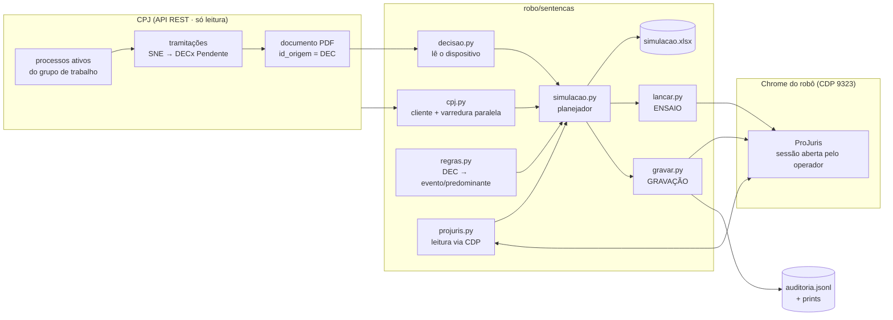
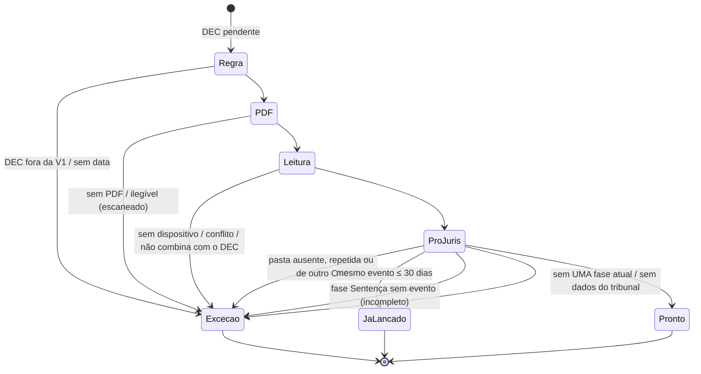

# Arquitetura

> Versão de portfólio. Todos os dados, IDs e nomes são fictícios; o "ProJuris" e o "CPJ" daqui
> são mocks locais (`mock/`) que imitam o que importa dos sistemas reais.

## Visão geral



## Módulos

| Módulo | Papel | Efeitos colaterais |
|---|---|---|
| `cpj.py` | Cliente da API (login com novas tentativas, Bearer, paginação `data/total_page`, retry em 401/429/5xx) e busca dos DECs pendentes (varredura com `ThreadPoolExecutor`). Erro **nunca** vira "não encontrado". | só leitura |
| `decisao.py` | Extrai o texto do PDF (pypdf), acha o dispositivo **do fim para o começo**, mascara pedido contraposto/reconvenção e classifica. `avaliar()` cruza com o DEC. | nenhum |
| `regras.py` | Tabela DEC → evento do ProJuris (por ID) → decisão predominante; constantes da fase. | nenhum |
| `simulacao.py` | Planejador: `pronto` / `já lançado` / `exceção` + planilha colorida. | grava `.xlsx` e PDFs baixados |
| `projuris.py` | Adaptador de leitura: conecta no Chrome via CDP, detecta tela de login (`SemSessao`), pasta → id interno pela Busca Rápida, lê as abas fases/eventos/documentos. | só leitura |
| `lancar.py` | ENSAIO: preenche as 4 janelas como uma pessoa e fecha pelo X. Prints de cada uma. | nenhum no sistema |
| `gravar.py` | GRAVAÇÃO: travas, S/N antes de cada Salvar, conferência após cada Salvar, auditoria. | **grava** (só liberados) |

## Estados do planejador



## Gravação — as 4 etapas

```mermaid
sequenceDiagram
    autonumber
    actor Op as Operador
    participant R as Robô (gravar.py)
    participant PJ as ProJuris (Chrome/CDP)
    R->>PJ: lê processo (fase atual, eventos, documentos)
    R->>Op: mostra plano + trecho da sentença — começar? [S/N]
    Op-->>R: S
    R->>PJ: Fases > Adicionar: "Sentença", atual, tribunal/comarca copiados
    R->>Op: Salvar a FASE? [S/N]
    R->>PJ: Salvar → relê → confere fase nova e atual
    R->>PJ: Registrar Decisão na fase nova (texto exato + F/D/P)
    R->>Op: Salvar a DECISÃO? [S/N]
    R->>PJ: Salvar → relê → confere julgada
    R->>PJ: Eventos > Adicionar (tipo por ID, ligado à fase nova)
    R->>Op: Salvar o EVENTO? [S/N]
    PJ-->>R: "Requisição N cadastrada com sucesso" [OK] — único aviso dispensado
    R->>PJ: confere evento na lista; ficha do evento abre
    R->>PJ: Documentos do evento > Adicionar (PDF, tipo Sentença, data)
    R->>Op: Salvar o DOCUMENTO? [S/N]
    R->>PJ: Salvar → confere na lista do evento
    R->>PJ: conferência final (evento + PDF dentro do evento)
    Note over R: cada passo → auditoria.jsonl + print
```

Qualquer outro aviso depois de um Salvar → o robô **não responde**, tira print, registra e para
(código 4). Se parar depois do evento, o subcomando `anexar` retoma só a etapa 4.

## Mock vs. sistema real

| Aspecto | Sistema real | Mock |
|---|---|---|
| Interface | ExtJS 3 (componentes, `Ext.ComponentMgr`, stores) | HTML + JS puro; dados em `window.PJ.stores` |
| Leitura | registros dos stores Ext dos grids | `PJ.stores[nome]` (mesma ideia) |
| Combos | `ComboBox` remoto; filtros dependentes disparam no `select` | combo próprio; a lista de comarcas só carrega com o clique na UF |
| Avisos | `Ext.Msg` | `#pj-msg` |
| CPJ | API v3 com headers próprios de integração | `/cpj/api/v3` com Bearer simples |

O fluxo, as travas e a ordem das etapas são os mesmos; o mock só simplifica o DOM.
